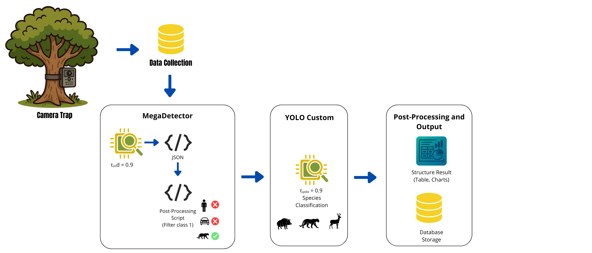
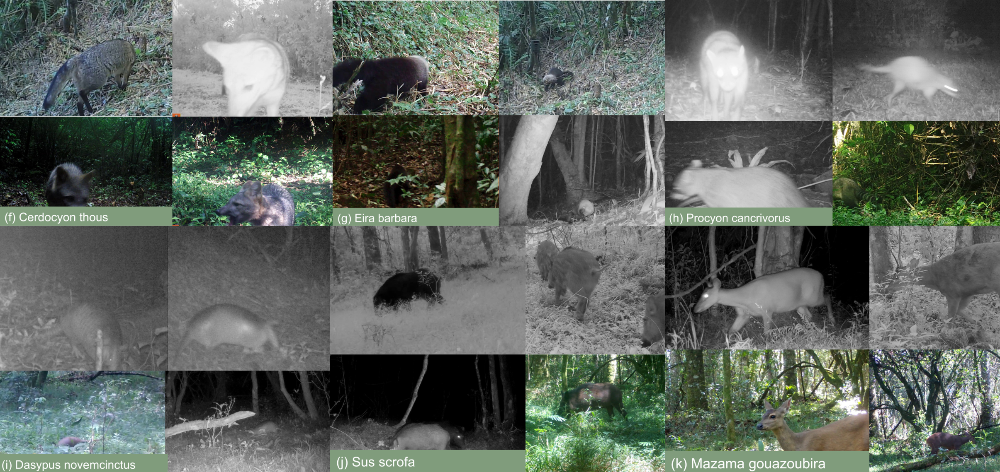
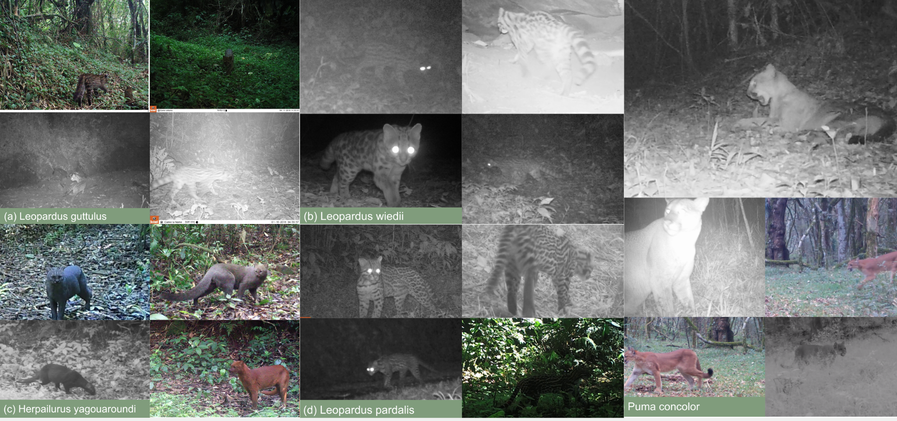

# A Locally Adapted Deep-Learning Workflow for Automated Mammal Recognition in Camera-Trap Imagery from Southern Brazil

This repository provides the companion code, reproducible Google Colab workflow, and documentation for the study "A locally adapted deep-learning workflow for automated mammal recognition in camera-trap imagery from southern Brazil." It presents a two-stage computer vision pipeline combining MegaDetector v5A for automated wildlife screening and a locally adapted YOLO11 object-detection model for recognizing 11 mammalian taxa in camera-trap photographs from southern Brazil, supporting scalable biodiversity monitoring within a human-in-the-loop framework.

## Architecture & Visual Overview

Image credits: Associação Civil Felinos do Aguaí and Parque Natural Municipal Mozart Rocha Loures.

## Systematic Workflow: Methodology, Operationalization, and Results

### 1. Methodology
1. **Study Sites & Image Compilation:** Camera-trap photographs (Bushnell Core DS No-Glow 30 MP, model 119977C) were compiled from two southern Brazilian forest contexts: *Parque Municipal Natural Mozart Rocha Loures* (Clevelândia, Paraná; Mixed Ombrophilous Forest / Araucaria Forest; Dec 2022–Jan 2025) and *Associação Civil Felinos do Aguaí* near *Reserva Biológica Estadual do Aguaí* (Siderópolis, Santa Catarina; Dense Ombrophilous Forest; 2015–2019), totaling **12,197** manually inspected images (**11,474** wildlife-positive [94.1%] and **723** empty [5.9%]).
2. **Reference Labelling & Taxonomy:** Manual review established presence/absence ground truth and object-level bounding-box annotations in **Roboflow** across **11 mammalian taxa** (5 felids: *Leopardus guttulus*, *Leopardus wiedii*, *Leopardus pardalis*, *Herpailurus yagouaroundi*, *Puma concolor*; and 6 other mammals: *Cerdocyon thous*, *Sus scrofa*, *Procyon cancrivorus*, *Mazama gouazoubira*, *Eira barbara*, *Dasypus novemcinctus*).
3. **Dataset Partitioning & Augmentation:** The **11,474** wildlife images were split at the image level into **80% training (9,254)**, **15% validation (1,673)**, and **5% test (547)**. Two YOLO11 configurations (`yolo11l.pt`, 100 epochs, `640 × 640`, GPU in Google Colab) were compared:
   - **Without data augmentation:** Trained on the original 9,254 training images.
   - **With data augmentation:** Training set expanded threefold to **27,742** images via Roboflow geometric transformations (3 outputs/example; horizontal/vertical flips; 90° clockwise/counter-clockwise rotations; free rotations from −15° to +15°), keeping validation and test sets untouched.
4. **Stage 1 — Automated Screening (MegaDetector v5A):** All **12,197** images were processed in Google Colab (GPU) via `run_detector_batch.py` (initial threshold `0.50` for score inspection; evaluated at `0.80`, `0.85`, and operational threshold `0.90` for animal-category detections, outputting JSON detections and quality-control overlays).
5. **Stage 2 — Local Taxonomic Detection (YOLO11) & Human-in-the-Loop Evaluation:** MegaDetector screening was evaluated at the image level (Precision, Recall, Specificity, F1-score), and YOLO11 models were evaluated on the validation set (1,673 images; 1,725 annotated instances) using Precision, Recall, **mAP50**, and **mAP50–95**, alongside human-effort reduction metrics (`HRMD` and automation coverage `AC`) within a human-in-the-loop review workflow.

### 2. Operationalization (Google Colab & Repository Execution)
1. **Environment Setup:** Open the Colab notebook from the GitHub repository, select a **GPU runtime**, clone/pull the repository, and install dependencies (`ultralytics`, `torch`, and helper utilities).
2. **Stage 1 Screening (`MegaDetector v5A`):** Run batch inference on new camera-trap photographs to generate detection JSONs, inspect confidence thresholds (e.g., `0.50` exploratory vs. `0.90` conservative), and separate candidate wildlife images from empty frames.
3. **Stage 2 Taxonomic Inference (`YOLO11`):** Load the custom YOLO11 weights (`best.pt`) and run object detection on wildlife images to obtain bounding boxes, predicted taxon labels, and confidence scores.
4. **Human-in-the-Loop Review & Export:** Route low-confidence detections, potential false negatives (especially under conservative thresholds), or ambiguous species predictions to expert/manual verification, and export structured results (CSV/JSON/annotated images) for ecological analysis.

### 3. Key Results
- **MegaDetector v5A Screening (12,197 images):** Generated **10,804** animal detections across **10,127** images at threshold `0.50` (scores `0.250–0.987`, mean `0.822 ± 0.163`, median `0.881`; retaining **72.1%** at `0.80`, **60.5%** at `0.85`, and **41.1%** [4,444 detections] at `0.90`). At threshold **`0.90`**, Precision = **1.000**, Specificity = **1.000**, Recall = **0.385**, and F1-score = **0.556**—showing zero false positives at high confidence, but a conservative recall that requires threshold calibration or human review to avoid missed records.
- **YOLO11 Taxonomic Detection (Validation: 1,673 images, 1,725 instances):**
  - *Without augmentation:* Precision = **0.979**, Recall = **0.987**, mAP50 = **0.991**, mAP50–95 = **0.865** (class mAP50 from `0.963` for *Sus scrofa* to `0.995` for five taxa; mAP50–95 from `0.792` for *Dasypus novemcinctus* and `0.795` for *Sus scrofa* to `0.935` for *Puma concolor*).
  - *With augmentation (27,742 training images):* Precision = **0.983**, Recall = **0.985**, mAP50 = **0.991**, mAP50–95 = **0.866**—yielding marginal aggregate gains and taxon-specific shifts (e.g., mAP50–95 rose for *Sus scrofa* [`0.795` → `0.811`] and *Puma concolor* [`0.935` → `0.942`], while dipping slightly for *Procyon cancrivorus* [`0.845` → `0.832`] and *Mazama gouazoubira* [`0.881` → `0.874`]).

## Quick Start in Google Colab
1. Click **Open In Colab** above (or open `notebook/How_to_Run.ipynb`).
2. Set the runtime hardware accelerator to **GPU** (`Runtime > Change runtime type > T4 GPU` or equivalent).
3. Run the setup and inference cells using sample camera-trap images and the released model weights.

> **Note on data & weights:** Depending on file size and data-sharing permissions for camera-trap imagery, raw field images may be restricted or provided as small sample examples, while trained model weights and notebooks are versioned via GitHub Releases / Zenodo.

## Authors & Contributors
- **Andressa A. de Paula**
- **Sebastián Narváez-Barrios**
- **Juliano A. Bogoni**
- **Manoel dos Santos Filho**
- **Micheli**
- **Mário M. Tagliari** (Corresponding author: `mariotagliari@utfpr.edu.br`)

## Citation & DOI
Once the GitHub release is linked to Zenodo, update the DOI badge and `CITATION.cff` with the assigned DOI:

> de Paula, A. A., Narváez-Barrios, S., Bogoni, J. A., dos Santos Filho, M., [Micheli], & Tagliari, M. M. (2026). *A locally adapted deep-learning workflow for automated mammal recognition in camera-trap imagery from southern Brazil* [Code and workflow]. GitHub / Zenodo. https://doi.org/10.5281/zenodo.XXXXXXX
