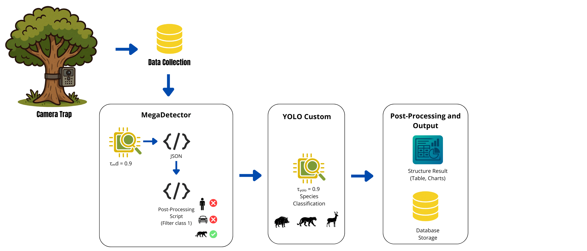
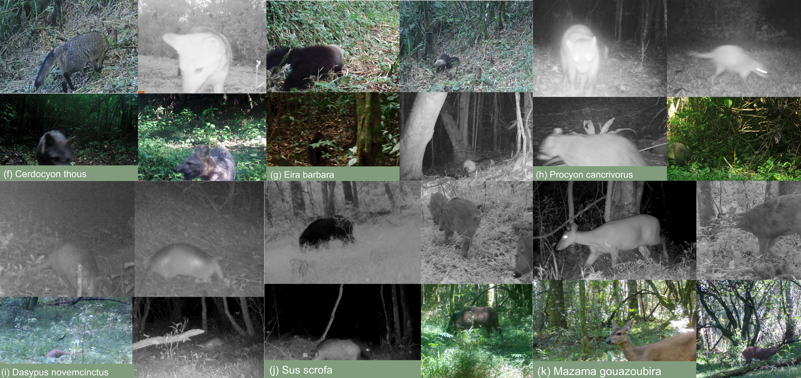
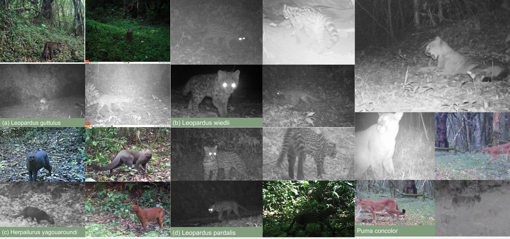

# Wildlife Detection in Camera-Trap Images
### Computer Vision and Deep Learning Applied to Wildlife Monitoring in the Araucaria Forest

---

## Overview

This project investigates the application of Artificial Intelligence and Computer Vision techniques to automate wildlife detection and identification in camera-trap images.

The research evaluates an automated workflow combining **MegaDetector v5A** and a custom-trained **YOLO11** model to process images collected from environmental conservation areas located in two distinct Brazilian forest formations: Mixed Ombrophilous Forest (Araucaria Forest) and Dense Ombrophilous Forest.

The proposed approach addresses the challenges associated with manual analysis of large volumes of camera-trap images, investigating automated methods for image screening, object detection, and species-level classification.

This study was developed as part of an undergraduate thesis in Systems Analysis and Development at Faculdade Municipal de Educação e Meio Ambiente (FAMA), Brazil, in 2025.
## Arquitetura
 

## Research Objectives

The main objective was to develop and evaluate an automated workflow based on Artificial Intelligence for wildlife screening, detection, and classification in camera-trap images.

Specific objectives:

- Evaluate MegaDetector v5A for automated identification of images containing wildlife.
- Develop and train a custom YOLO11 object detection model using real-world camera-trap data.
- Evaluate model performance using object detection metrics.
- Compare the results of different training configurations.
- Investigate the applicability of automated detection models to environmental monitoring.

## Dataset

### Data Sources

The research used images obtained from camera traps installed in two different forest environments:

| Data Source | Location | Forest Formation |
|---|---|---|
| Parque Municipal Natural Mozart Rocha Loures | Clevelândia, Paraná, Brazil | Mixed Ombrophilous Forest |
| Associação Felinos do Aguaí | Siderópolis, Santa Catarina, Brazil | Dense Ombrophilous Forest |

### Dataset Composition

A total of **12,197 images** were manually reviewed and classified.

| Category | Number of Images |
|---|---:|
| Images containing wildlife | 11,474 |
| Empty images | 723 |
| **Total** | **12,197** |

Manual classification was used as the reference for evaluating the MegaDetector model and identifying wildlife images for the subsequent YOLO11 training stage.

### Detection Classes

The custom YOLO11 model was organized into 11 taxonomic classes, including five felid classes and six additional mammal classes.

The species represented in the experimental results include:

| Scientific Name |
|---|
| *Cerdocyon thous* |
| *Sus scrofa* |
| *Procyon cancrivorus* |
| *Mazama gouazoubira* |
| *Leopardus guttulus* |
| *Leopardus wiedii* |
| *Eira barbara* |
| *Herpailurus yagouaroundi* |
| *Leopardus pardalis* |
| *Puma concolor* |
| *Dasypus novemcinctus* |

## Methodology

The research was organized into three main stages.

### 1. Manual Image Classification

The original camera-trap images were manually inspected to identify:

- Presence or absence of wildlife.
- Species represented in positive images.
- Images suitable for subsequent model evaluation and training.

This process established the reference classifications used in the experiments.

### 2. Automated Screening with MegaDetector v5A

MegaDetector v5A was used as an initial object detection and screening stage.

The model processed the same 12,197 images previously classified manually.

The experiment focused on identifying images containing wildlife and filtering empty images.

**Experimental Configuration**

| Parameter | Configuration |
|---|---|
| Model | MegaDetector v5A |
| Execution Environment | Google Colab |
| Hardware | GPU |
| Confidence Threshold | 0.90 |

**Evaluation Results**

| Metric | Result |
|---|---:|
| Precision | 1.000 |
| Recall | 0.385 |
| Specificity | 1.000 |
| F-score | 0.556 |

The results indicate high precision and specificity, but considerably lower recall at the selected confidence threshold.

This behavior demonstrates the importance of confidence threshold selection and complementary manual review when applying automated detection to ecological datasets.

### 3. Custom YOLO11 Training

Images manually classified as containing wildlife were used to train a custom object detection model based on YOLO11.

The dataset was organized into 11 taxonomic classes.

**Training Configuration**

| Parameter | Configuration |
|---|---|
| Architecture | YOLO11 |
| Pretrained Weights | `yolo11l.pt` |
| Training Environment | Google Colab |
| Hardware | GPU |
| Epochs | 100 |
| Image Size | 640 × 640 |
| Training Split | 80% |
| Validation Split | 15% |
| Test Split | 5% |
| Annotation Platform | Roboflow |

Two model configurations were evaluated.

#### Model 1 — Original Dataset

The first model was trained using the original annotated dataset without additional data augmentation.

#### Model 2 — Data Augmentation

The second model incorporated data augmentation techniques to increase training data diversity.

The resulting training dataset contained **27,742 images**.

Applied transformations:

| Transformation | Configuration |
|---|---|
| Outputs per Example | 3 |
| Horizontal Flip | Enabled |
| Vertical Flip | Enabled |
| 90° Rotation | Clockwise and Counter-clockwise |
| Free Rotation | Between -15° and +15° |

The two configurations were compared to investigate the impact of data augmentation on detection performance.

## Experimental Results

### YOLO11 Performance Comparison

The overall results obtained by both configurations are presented below.

| Metric | Model 1 | Model 2 |
|---|---:|---:|
| Precision | 0.979 | 0.983 |
| Recall | 0.987 | 0.985 |
| mAP50 | 0.991 | 0.991 |

### Results Interpretation

The comparative evaluation showed that data augmentation produced a slight increase in precision, from 0.979 to 0.983.

Recall decreased slightly, from 0.987 to 0.985, while mAP50 remained unchanged at 0.991.

These results indicate that both configurations achieved similar overall detection performance.

The augmented configuration demonstrated a small improvement in precision, while maintaining high recall and object localization performance.

### Evaluation Metrics

The following metrics were used in the experiments:

- **Precision:** Measures the proportion of positive detections that are correct.
- **Recall:** Measures the proportion of actual positive instances successfully detected.
- **Specificity:** Measures the proportion of negative instances correctly identified.
- **F-score:** Harmonic mean of precision and recall.
- **mAP50:** Mean Average Precision calculated at an Intersection over Union (IoU) threshold of 0.5.

## Technologies and Tools

| Technology | Application |
|---|---|
| Python | Model development and data processing |
| MegaDetector v5A | Initial image screening |
| YOLO11 | Custom wildlife object detection |
| PyTorch | Deep learning framework |
| Ultralytics | YOLO11 training and evaluation |
| Google Colab | Experimental execution and GPU processing |
| Roboflow | Image annotation and dataset management |
| MySQL | Storage and organization of inference results |

## Limitations

The experiments were conducted using a specific dataset collected from two forest environments.

The reported metrics represent the performance observed under the experimental conditions described in the research and should not be interpreted as a guarantee of equivalent performance in other environments or datasets.

The MegaDetector experiment also demonstrated that a high confidence threshold can reduce recall, reinforcing the importance of reviewing missed detections.

Further studies could investigate:

- Model generalization across different ecological environments.
- Performance under different confidence thresholds.
- Additional data augmentation strategies.
- Evaluation with larger and more diverse datasets.
- Integration with ecological monitoring and analysis systems.

## References

The research was based on scientific literature concerning camera-trap monitoring, computer vision, deep learning, and wildlife conservation.

Selected references:

- Fennell, M.; Beirne, C.; Burton, A. C. (2022). Accelerating camera trap image processing with MegaDetector and ecological context.
- Schneider, S. et al. (2018). Deep learning object detection methods for ecological camera trap data.
- Ferrante, L. et al. (2024). Evaluating YOLO architectures for detecting road killed endangered Brazilian animals.
- Trolliet, F. et al. (2014). Use of camera traps for wildlife studies: A review.
- Tuia, D. et al. (2022). Perspectives in machine learning for wildlife conservation.

For the complete bibliography, see `docs/references.md`.

## Citation

If you use or reference this research, please cite the original undergraduate thesis:

**PAULA, Andressa Almeida de.** *Desafios na Identificação de Fauna com Camera-Trap: Uso de Modelos de Detecção na Mata de Araucárias.* 2025. Trabalho de Conclusão de Curso (Tecnologia em Análise e Desenvolvimento de Sistemas) — Faculdade Municipal de Educação e Meio Ambiente, Clevelândia, Paraná, 2025.

## Author

**Andressa Almeida de Paula**

Research interests:

- Artificial Intelligence
- Computer Vision
- Deep Learning
- Wildlife Monitoring
- Data Science

---

*Academic research project developed in 2025.*
